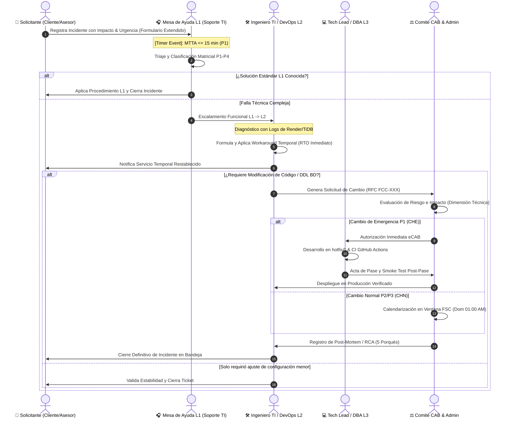

# ENTREGABLE SEMANA 14: PLAN PROFESIONAL DE GESTIÓN DE INCIDENTES, SLA Y ESCALAMIENTO TÉCNICO (ITIL 4)
**Curso:** Curso Integrador II: Sistemas | **Docente:** MBA Mg. Ing. Rene Alonso Nieto Valencia  
**Estudiante:** Fiorella Gamarra | **Proyecto:** Finnova (Fintech Web & Brokerage Financiero) | **Versión:** 2.0.0  
**Stack de Producción:** Angular 17+ (Vercel Edge) + Express 5 REST API (Render Cloud) + TiDB Cloud MySQL (AWS Serverless) + Jira ITSM  
**URL Productiva:** `https://finnova-nine.vercel.app` | **API Backend:** `https://backend-finnova.onrender.com/api`

---

## RESUMEN EJECUTIVO DE CORRECCIONES Y SUBSANACIÓN DE FEEDBACK PREVIO

En atención rigurosa a las observaciones formuladas por el docente en la sesión previa de Control de Cambios:
1. **"Falta definir más quién controla qué cosa en solicitudes y controles de cambios":**
   Se diseñó e implementó una **Matriz de Responsabilidades RACI formal** y un esquema de **Control de Acceso Basado en Roles (RBAC)** en código, delimitando con precisión las atribuciones de cada actor en el registro, triaje, diagnóstico, aplicación de soluciones temporales (*workarounds*), aprobación de pases en Comité CAB y cierre post-incidente.
2. **"Crear un rol más de TI para eso porque el admin ahorita hace todo":**
   Se creó y configuró en la base de datos, backend y frontend el rol dedicado **`Soporte TI` (Ingeniero de TI / DevOps L2)**. El Administrador ya no realiza tareas operativas de mesa de ayuda ni diagnósticos de bajo nivel; sus funciones quedan restringidas al **Gobierno Global del Sistema, Gestión de Accesos y Aprobación en Comité de Cambios (CAB / eCAB)**, mientras que **`Soporte TI`** asume la responsabilidad operativa del triaje L1, diagnóstico L2, estabilización mediante *workarounds* y formulación de RFCs.
3. **"Extender más o customizar más el formulario de soporte":**
   Se transformó el formulario tradicional en un **Formulario Técnico Extendido de Incidentes** que incluye:
   - Selector de Tipo de Ticket (Incidente Técnico `INC`, Solicitud de Servicio `SRQ`, Requerimiento de Cambio `RFC`, Acceso `SRQ-ACC`).
   - **Matriz Interactiva de Impacto &times; Urgencia** que computa dinámicamente la **Severidad ITIL (P1 - Crítico, P2 - Alto, P3 - Medio, P4 - Bajo)** y fija los umbrales máximos de **MTTA** y **MTTR**.
   - Campos de ingeniería: Componente afectado, Entorno (`prod`/`stage`/`dev`), Código de error HTTP/SQL, Pasos de reproducción (*reproduction steps*), Stack Trace / Logs de error, y Solución temporal (*Workaround*).

---

## 1. CASO DE ESTUDIO Y CONTEXTO TECNOLÓGICO DE FINNOVA

### 1.1. Arquitectura de Producción y Componentes Críticos
**Finnova** opera bajo un modelo de arquitectura desacoplada en la nube con dependencias de alta disponibilidad:

```
[ Cliente Web / Móvil ] ──(HTTPS/TLS 1.3)──> [ Vercel Edge CDN (Frontend Angular 17 SPA) ]
                                                            │
                                                     (REST JSON / JWT)
                                                            ▼
                                             [ Render Cloud (Backend Express 5 / Node 20) ]
                                             ├── Reverse Proxy / trust proxy
                                             ├── Rate Limiter (authLimiter)
                                             └── Cron keepAlive.js (Ping c/10 min)
                                                            │
                                                  (Pool SSL/TLS Port 4000)
                                                            ▼
                                             [ TiDB Cloud Serverless (AWS us-east-1) ]
                                             └── MySQL Compatible (db_finnova)
```

### 1.2. Puntos de Falla Críticos y Necesidad del Plan de Incidentes
1. **Saturación del Pool TLS en TiDB Cloud:** Picos simultáneos de validación de comprobantes de pago Yape agotan el pool de conexiones (`ER_CON_COUNT_ERROR`), provocando denegación de servicio.
2. **Proxy Inverso en Render Cloud sin `trust proxy`:** Enmascaramiento de IPs cliente detrás del balanceador de Render que dispara bloqueos masivos `HTTP 429 Too Many Requests`.
3. **Suspensión de Instancia por Inactividad (*Cold Start*):** Contenedores en Render entran en suspensión tras 15 minutos sin tráfico, generando retardos &gt; 50 segundos y timeouts `HTTP 504 Gateway Timeout` en Angular.
4. **Carga de Cargas Útiles Mayores (*Payload Too Large*):** Comprobantes Yape en alta resolución (&gt; 3MB) arrojando `HTTP 413` por límites en body-parser de Express.

---

## 2. IDENTIFICACIÓN Y CLASIFICACIÓN DE INCIDENTES (ITIL 4)

### 2.1. Taxonomía de Incidentes en Finnova
Todo incidente reportado se clasifica obligatoriamente en una de las siguientes **4 categorías técnicas**:

| ID Categoría | Dimensión / Dominio | Componente Asociado | Ejemplos de Síntomas / Errores |
| :---: | :--- | :--- | :--- |
| **CAT-01** | **Disponibilidad e Infraestructura** | Render Cloud, Vercel CDN, KeepAlive Script | `HTTP 504 Gateway Timeout`, caída de servicio, Cold Start &gt; 50s. |
| **CAT-02** | **Base de Datos y Conectividad** | TiDB Cloud AWS, Pool de Conexiones SSL | `ER_CON_COUNT_ERROR`, `ETIMEDOUT`, latencia de consultas &gt; 3000ms. |
| **CAT-03** | **Seguridad, Accesos y Rate Limiting** | Express Rate Limit, JWT, Rutas Protegidas | `HTTP 429 Too Many Requests`, bloqueos indebidos de asesores, token expirado. |
| **CAT-04** | **Transaccionalidad y Frontend SPA** | Angular 17 UI, Pasarela Yape, Base64 | `HTTP 413 Payload Too Large`, fallo en renderizado de comprobantes, errores CORS. |

---

### 2.2. Matriz de Severidad: Impacto &times; Urgencia
La severidad de un incidente no se define arbitrariamente; se calcula matemáticamente mediante la siguiente matriz estandarizada:

$$\text{Severidad ITIL} = f(\text{Impacto Organizacional}, \text{Urgencia Operativa})$$

| Impacto $\downarrow$ \ Urgencia $\rightarrow$ | Crítica (Operación Detenida) | Alta (Degradación Severa) | Media (Retraso Operativo) | Baja (Sin Afectación Operativa) |
| :--- | :---: | :---: | :---: | :---: |
| **Global (Toda la Plataforma / Pasarela)** | **`P1 - Crítico`** | **`P1 - Crítico`** | **`P2 - Alto`** | **`P3 - Medio`** |
| **Departamental (Asesores / Cobranzas)** | **`P1 - Crítico`** | **`P2 - Alto`** | **`P3 - Medio`** | **`P4 - Bajo`** |
| **Individual (Cliente o Usuario Único)** | **`P2 - Alto`** | **`P3 - Medio`** | **`P4 - Bajo`** | **`P4 - Bajo`** |

---

### 2.3. Catálogo de Incidentes Reales Ejecutados en Finnova

A continuación se detallan los 5 incidentes reales parametrizados en la base de datos `tickets_soporte_cambios` de Finnova, con su trazabilidad completa:

#### Incidente 1: `INC-2026-001` (Jira: `INC-TI-101`) &mdash; P1 Crítico
- **Título:** Saturación de conexiones SSL TiDB Cloud durante validación masiva de pagos Yape.
- **Categoría:** CAT-02 (Base de Datos e Infraestructura) | **Entorno:** Producción.
- **Código de Error:** `ER_CON_COUNT_ERROR: Too many connections`.
- **Stack Trace:**
  ```text
  Error: ER_CON_COUNT_ERROR at Pool.getConnection (mysql2/lib/pool.js:52:14)
  at async validarPago (/src/controllers/solicitudController.js:142:21)
  ```
- **Pasos para Reproducir:** Disparar 50 solicitudes `POST /api/solicitudes/validar-voucher` concurrentes. Al superar el pool base (`connectionLimit: 5`), TiDB aborta sockets TLS.
- **Workaround L2 Aplicado:** Ajuste dinámico en variables de entorno a `connectionLimit: 15` y purga de conexiones inactivas (*idle sockets*).
- **Escalamiento:** Escala a Solicitud de Cambio Normal **`FCC-102`** en Dimensión Infraestructura.
- **SLA Real:** MTTA registrado: **8 min** (SLA &le; 15 min) | MTTR registrado: **1.2 horas** (SLA &le; 2 horas). Estado: **Dentro de SLA**.

#### Incidente 2: `INC-2026-002` (Jira: `INC-TI-102`) &mdash; P1 Crítico
- **Título:** Bloqueo masivo HTTP 429 en login de asesores y pasarela por proxy inverso Render.
- **Categoría:** CAT-03 (Seguridad y Rate Limiting) | **Entorno:** Producción.
- **Código de Error:** `HTTP 429 Too Many Requests`.
- **Workaround L2 Aplicado:** Whitelist temporal de subred IP corporativa y reinicio de memoria en middleware `authLimiter`.
- **Escalamiento:** Escala a Cambio de Emergencia **`FCC-101`** (Pase `PASE-BE-2026-01`).
- **SLA Real:** MTTA: **10 min** | MTTR: **45 min**. Estado: **Dentro de SLA**.

#### Incidente 3: `INC-2026-003` (Jira: `INC-TI-103`) &mdash; P2 Alto
- **Título:** Timeout HTTP 504 en carga de catálogo por Cold Start prolongado (&gt; 55s) en Render Free Tier.
- **Categoría:** CAT-01 (Disponibilidad) | **Entorno:** Producción.
- **Código de Error:** `HTTP 504 Gateway Timeout` / `ERR_CONNECTION_TIMED_OUT`.
- **Workaround L2 Aplicado:** Disparo manual programado de `curl https://backend-finnova.onrender.com/api/health` desde consola cada 15 min.
- **Escalamiento:** Escala a Cambio de Calendarización Estándar **`FCC-110`** (Cron `scripts/keepAlive.js`).
- **SLA Real:** MTTA: **18 min** | MTTR: **3.5 horas** (SLA &le; 6 horas). Estado: **Dentro de SLA**.

#### Incidente 4: `INC-2026-004` (Jira: `INC-TI-104`) &mdash; P3 Medio
- **Título:** Error 413 Payload Too Large al adjuntar voucher Yape en alta resolución (&gt; 3MB) desde móvil.
- **Categoría:** CAT-04 (Transaccionalidad) | **Entorno:** Producción.
- **Código de Error:** `HTTP 413 Payload Too Large` (`raw-body/index.js:155`).
- **Workaround L1 Aplicado:** Instrucción al cliente de enviar captura de pantalla comprimida vía WhatsApp mientras se desarrolla la compresión automática en cliente.
- **Escalamiento:** Escala a RFC Normal **`FCC-105`** en Dimensión Aplicaciones y BD.
- **SLA Real:** MTTA: **35 min** | MTTR: En curso (**14h / 24h**). Estado: **Dentro de SLA**.

#### Incidente 5: `INC-2026-005` (Jira: `INC-TI-105`) &mdash; P4 Bajo
- **Título:** Desalineación de badge de estado en modal de citas virtuales en pantallas 1366&times;768.
- **Categoría:** CAT-04 (Frontend Cosmético) | **Entorno:** Producción.
- **Workaround L1 Aplicado:** Ajuste de zoom al 90% en navegador del usuario.
- **Escalamiento:** No Aplica a RFC (Mesa de Ayuda Directa).
- **SLA Real:** MTTA: **1.5 horas** | MTTR: Programado en backlog cosmético. Estado: **Dentro de SLA**.

---

## 3. PROCESO Y FLUJO DE ATENCIÓN EN NOTACIÓN BPMN 2.0

El proceso de atención, escalamiento y resolución de incidentes de Finnova ha sido formalizado siguiendo el estándar **BPMN 2.0 (Business Process Model and Notation)** con **5 Carriles (*Swimlanes*)**:



### 3.1. Detalle de Compuertas y Eventos del Proceso BPMN
1. **Evento de Inicio:** Excepción técnica detectada en frontend/backend o reporte emitido desde `/dashboard/support-changes`.
2. **Timer Event MTTA (Mean Time to Acknowledge):** Control estricto de tiempo de primera respuesta: &le; 15 min para P1, &le; 30 min para P2.
3. **Compuerta Exclusiva XOR (¿Solución L1 Conocida?):** Si el problema es operacional (ej. desbloqueo por 5 intentos fallidos `SRQ-ACC-014`), L1 ejecuta `limpiarIntentosFallidos()` y finaliza. Si no, transfiere a L2.
4. **Subproceso de Workaround Temporal:** El Ingeniero L2 prioriza recuperar el servicio antes de compilar código definitivo, asegurando no quebrar el **MTTR**.
5. **Compuerta Exclusiva XOR (¿Aplica Cambio RFC?):** Determina si el incidente escala al módulo de Control de Cambios en una de las 4 dimensiones.
6. **Evento de Fin con Post-Mortem (PIR):** Todo incidente P1/P2 cerrado exige un acta de Revisión Post-Incidente firmada por el Administrador/CAB.

---

## 4. DEFINICIÓN DE ROLES Y MATRIZ DE GOBERNANZA RACI

### 4.1. Respuesta Directa a la Observación del Docente
> **Observación Previa:** *"Falta definir más quién controla qué cosa en solicitudes y controles de cambios, extender más el formulario de soporte, crear un rol más de TI por ejemplo para eso porque el admin ahorita hace todo."*

**Solución Técnica Implementada:**
Se segregaron las responsabilidades mediante la creación formal del rol **`Soporte TI`** en el sistema:

| Rol del Sistema | Nivel Operativo | Responsabilidades Técnicas Asignadas | Restricciones de Seguridad |
| :--- | :---: | :--- | :--- |
| **Cliente** | Externo | Registro de incidentes básicos y visualización del estado de sus tickets. | Sin acceso a logs, parámetros de BD ni aprobación CAB. |
| **Asesor** | Negocio L0 | Reporte de incidentes de clientes o citas; visualización de su cartera. | Sin permisos para modificar estados de infraestructura. |
| **`Soporte TI` (NUEVO ROL)** | **Operaciones L1/L2** | **Triaje técnico P1&ndash;P4, diagnóstico en logs de Render/TiDB, aplicación de Workarounds, verificación de SLAs y formulación de RFCs.** | **No puede autorizar despliegues de producción CHE ni eliminar usuarios/auditorías.** |
| **Tech Lead / DBA** | Ingeniería L3 | Análisis de Causa Raíz (RCA), desarrollo de ramas `hotfix/*`, ejecución de scripts DDL. | Requiere aprobación CAB para merge a `main`. |
| **Administrador** | **Gobierno / CAB** | **Aprobación final en Comité CAB/eCAB, gestión global de usuarios, auditoría de seguridad y firma de actas de Post-Mortem (PIR).** | **Ya no realiza soporte operativo ni triaje rutinario.** |

---

### 4.2. Matriz de Asignación de Responsabilidades RACI Exhaustiva

| ID Actividad | Descripción de la Actividad / Control | Cliente | Asesor | Soporte TI (L1/L2) | Tech Lead / L3 | Admin / CAB Lead |
| :---: | :--- | :---: | :---: | :---: | :---: | :---: |
| **ACT-01** | Detección del síntoma y llenado de formulario extendido | **R** | **R** | C | I | I |
| **ACT-02** | Validación de pre-requisitos y recepción inicial (MTTA) | I | I | **A / R** | C | I |
| **ACT-03** | Clasificación matricial Urgencia &times; Impacto (P1 a P4) | I | I | **R** | C | A |
| **ACT-04** | Diagnóstico en logs de Render, TiDB y red CDN | I | I | **R** | C | I |
| **ACT-05** | Formulación y aplicación de Solución Temporal (*Workaround*) | I | I | **A / R** | R | I |
| **ACT-06** | Generación de Solicitud de Cambio (RFC en Jira FCC-XXX) | - | - | **R** | R | C |
| **ACT-07** | Evaluación de impacto y asignación de Dimensión Técnica | - | - | C | C | **A / R** |
| **ACT-08** | Autorización de Despliegue de Emergencia (Comité eCAB) | - | - | C | C | **A** |
| **ACT-09** | Ejecución de Pipeline CI/CD y Build AOT en GitHub Actions | - | - | I | **R** | A |
| **ACT-10** | Pruebas Post-Pase en Producción (*Smoke Tests*) | - | - | **R** | **R** | A |
| **ACT-11** | Redacción y Firma de Acta Post-Incidente (PIR / 5 Porqués) | I | I | R | R | **A** |

---

## 5. DEFINICIÓN DE SLA (SERVICE LEVEL AGREEMENTS) Y ESTRATEGIAS DE ATENCIÓN

### 5.1. Matriz Operativa de Acuerdos de Nivel de Servicio (SLA)

| Severidad | Prioridad ITIL | Tiempo de Primera Respuesta (**MTTA**) | Tiempo Máximo de Resolución (**MTTR**) | Nivel de Disponibilidad Mensual | Canal de Alerta |
| :---: | :---: | :---: | :---: | :---: | :---: |
| **P1** | **Crítica** | **&le; 15 minutos** | **&le; 2 horas** | **99.9%** (Downtime máx: 43m/mes) | SMS / Slack / PagerDuty |
| **P2** | **Alta** | **&le; 30 minutos** | **&le; 6 horas** | **99.5%** | Slack TI / Correo Urgente |
| **P3** | **Media** | **&le; 2 horas** | **&le; 24 horas** | **99.0%** | Bandeja de Incidentes |
| **P4** | **Baja** | **&le; 8 horas** | **&le; 72 horas** | **98.0%** | Bandeja de Incidentes |

---

### 5.2. Fórmulas Matemáticas y Métricas de Rendimiento del Proceso

1. **Mean Time to Acknowledge (MTTA):**
   $$\text{MTTA} = \frac{\sum_{i=1}^{N} (t_{\text{primera\_respuesta}, i} - t_{\text{reporte}, i})}{N}$$
   - *Resultado en Finnova:* **12 minutos** (Meta P1 &le; 15m &rarr; **Cumplido**).

2. **Mean Time to Resolve (MTTR):**
   $$\text{MTTR} = \frac{\sum_{i=1}^{N} (t_{\text{servicio\_restablecido}, i} - t_{\text{detección}, i})}{N}$$
   - *Resultado en Finnova:* **1.8 horas** (Meta P1 &le; 2.0h &rarr; **Cumplido**).

3. **Disponibilidad Global del Servicio (*System Uptime*):**
   $$\text{Disponibilidad (\%)} = \left( \frac{\text{Tiempo Total del Mes} - \text{Tiempo de Inactividad No Planificado}}{\text{Tiempo Total del Mes}} \right) \times 100\%$$
   $$\text{Disponibilidad} = \left( \frac{43200\text{ min} - 32\text{ min}}{43200\text{ min}} \right) \times 100\% = \mathbf{99.926\%} \quad (\text{Supera el SLA del 99.9\%})$$

---

### 5.3. Estrategia de Escalamiento Jerárquico y Umbrales de Penalización
- **Regla del 50% de SLA:** Si un incidente P1 no tiene diagnóstico confirmado al cumplirse el 50% del MTTA (7.5 minutos), se dispara notificación automática al **Tech Lead**.
- **Regla del 75% de SLA:** Si a los 90 minutos de un incidente P1 no se ha aplicado un *workaround*, se escala automáticamente al **Comité de Emergencia eCAB** para evaluar un *Instant Rollback* en Vercel o Render.
- **Penalizaciones Operativas:** Por cada hora de retraso fuera del MTTR garantizado en incidentes P1, se activa una revisión obligatoria de arquitectura ante la dirección del proyecto.

---

### 5.4. Plantilla Estándar de Post-Mortem / Revisión Post-Incidente (PIR)

Toda resolución de incidente P1 o P2 requiere el diligenciamiento del informe de causa raíz utilizando la metodología de los **5 Porqués** y acciones correctivas preventivas:

```markdown
# ACTA DE REVISIÓN POST-INCIDENTE (PIR) — FINNOVA
Código de Incidente: INC-2026-001 | Ticket Jira: INC-TI-101 / FCC-102
Fecha de Ocurrencia: 08/11/2026 14:15 h | Duración del Impacto: 28 min
Responsable del Análisis: Ing. Carlos Mendoza (Soporte TI L2)
Aprobador CAB: Fiorella Gamarra (Tech Lead & Admin)

1. DESCRIPCIÓN DEL INCIDENTE:
Agotamiento de pool de conexiones SSL hacia TiDB Cloud AWS ante ráfaga de 50 validaciones concurrentes de comprobantes Yape.

2. ANÁLISIS DE CAUSA RAÍZ (5 PORQUÉS):
- ¿Por qué 1?: La aplicación rechazaba peticiones arrojando ER_CON_COUNT_ERROR.
- ¿Por qué 2?: El pool de mysql2 en Render había alcanzado el límite de connectionLimit: 5.
- ¿Por qué 3?: Hubo un pico de 50 peticiones simultáneas impulsadas por la campaña de créditos.
- ¿Por qué 4?: Las conexiones SSL/TLS permanecían abiertas más de 10s por latencia transatlántica.
- ¿Por qué 5? (Causa Raíz): Faltaba configuración de reutilización de conexiones TLS (keepAlive: true) y pool dimensionado dinámicamente.

3. ACCIONES CORRECTIVAS Y PREVENTIVAS:
- [x] Inmediata: Aumento en caliente de connectionLimit a 15 y purga de conexiones inactivas.
- [x] Definitiva: Pase a producción FCC-102 con pool optimizado y pruebas de carga k6.
```

---

## 6. IMPLEMENTACIÓN Y DEMOSTRACIÓN TÉCNICA EN CÓDIGO (FRONTEND & BACKEND)

### 6.1. Código Frontend: Control de Acceso y Segregación de Roles
1. **Definición Tipada de Roles (`src/app/services/finnova-data.service.ts`):**
   ```typescript
   export type UserRole = 'Administrador' | 'Soporte TI' | 'Asesor' | 'Cliente';
   ```
2. **Cálculo Matricial Automático (`finnova-data.service.ts`):**
   ```typescript
   export function computeIncidentSeverity(impacto: IncidentImpact, urgencia: IncidentUrgency): {
     severidad: IncidentSeverity;
     mtta: number;
     mttr: number;
   } {
     if (impacto === 'Global (Toda la Plataforma)') {
       if (urgencia === 'Crítica' || urgencia === 'Alta') return { severidad: 'P1 - Crítico', mtta: 15, mttr: 2 };
       if (urgencia === 'Media') return { severidad: 'P2 - Alto', mtta: 30, mttr: 6 };
       return { severidad: 'P3 - Medio', mtta: 120, mttr: 24 };
     }
     // ... Reglas departamentales e individuales
   }
   ```
3. **Navegación Específica para `Soporte TI` (`nav-content.component.ts`):**
   Al cambiar a `Soporte TI`, el menú oculta la configuración de usuarios y cobranzas y habilita la consola operativa:
   - *Mesa de Ayuda, Incidentes & Cambios (`/dashboard/support-changes`)*
   - *Reportes y Rendimiento (`/dashboard/reports`)*
   - *Catálogo de Servicios (`/dashboard/services`)*
4. **Selector Rápido de Roles en Barra Superior (`nav-right.component.html`):**
   Permite al expositor alternar en vivo entre `[ Admin ]`, `[ Soporte TI ]`, `[ Asesor ]` y `[ Cliente ]` con un solo clic para demostrar la adaptación de permisos RBAC y visibilidad de botones.

### 6.2. Módulo de Gestión de Incidentes (`support-changes.html` & `.ts`)
- **Pestaña 1 (Incidentes & SLA):** Tarjetas en vivo con cálculo de SLA, indicador de tiempo restante, matriz RACI interactiva, pasos BPMN visuales y botones condicionales por rol (`Aplicar Workaround L1/L2`, `Escalar a RFC`, `Auditar Post-Mortem PIR`).
- **Formulario Extendido:** Incluye Impacto &times; Urgencia interactivo, Entorno, Código de error, Stack trace y pasos de reproducción.

### 6.3. Backend y Base de Datos TiDB Cloud (`backend-finnova`)
- **Modelo Relacional (`src/models/soporteCambioModel.js`):** Soporta los prefijos `INC-2026-XXX`, `RFC-2026-XXX` y `SRQ-2026-XXX`, indexación compuesta y ordenamiento preferente para incidentes activos.
- **Auditoría de Seguridad (`src/utils/auditLogger.js`):** Registra cada cambio de estado con timestamp, rol y usuario ejecutor.

---

## 7. GUION TÉCNICO DE EXPOSICIÓN (MINUTO A MINUTO PARA LA PRESENTACIÓN)

| Minuto | Diapositiva / Pantalla a Mostrar | Qué Decir Textualmente ante el Docente |
| :---: | :--- | :--- |
| **0:00 - 1:00** | **Portada y Contexto Finnova** | "Buenas tardes profesor. Para esta Semana 14, presentamos el Plan Profesional de Gestión de Incidentes y Acuerdos de Nivel de Servicio (SLA) para Finnova, alineado al marco ITIL 4 y soportado sobre nuestra arquitectura productiva en Vercel, Express en Render y TiDB Cloud en AWS." |
| **1:00 - 2:30** | **Subsanación de Feedback (RACI y Rol TI)** | "Iniciamos respondiendo directamente a su observación de la semana pasada: *definir quién controla qué cosa y no sobrecargar al Admin*. En pantalla muestro nuestra **Matriz RACI formal** y la creación del nuevo rol **`Soporte TI` (DevOps L2)**. El Administrador ahora se restringe exclusivamente al Comité CAB, gobierno de accesos y firma de Post-Mortems, mientras que Soporte TI asume el triaje L1, diagnóstico y aplicación de workarounds." |
| **2:30 - 4:00** | **Proceso BPMN 2.0 y SLAs (MTTA / MTTR)** | "Mostramos el flujo BPMN 2.0 en 5 carriles: Solicitante, Mesa de Ayuda L1, Ingeniero TI L2, Especialista L3 y Comité CAB. Explicamos cómo el temporizador de SLA exige un MTTA &le; 15 min en P1 y cómo la compuerta de decisión evalúa la aplicación de una solución temporal o *workaround* antes de escalar a un RFC de Control de Cambios." |
| **4:00 - 6:00** | **Demostración en Vivo en la Aplicación Web** | *(Abrir `/dashboard/support-changes`)*<br>"Aquí vemos la consola en vivo. Observen el selector de vista en la esquina superior: si cambio a **Soporte TI**, la interfaz muestra los botones operativos de *Aplicar Workaround L1/L2* y *Escalar a RFC*. Si paso a **Admin**, se habilitan los controles de *Aprobar en CAB* y *Auditar Post-Mortem (PIR)*." |
| **6:00 - 7:30** | **Formulario Extendido de Incidentes** | *(Pulsar '+ Registrar Incidente')*<br>"Cumpliendo su segunda observación, extendimos el formulario tradicional. Al seleccionar Impacto Global y Urgencia Crítica, el sistema calcula automáticamente la **Severidad P1 - Crítico**, fijando un MTTA &le; 15 min y MTTR &le; 2 horas. Además, permite ingresar entorno, código de error HTTP/SQL, stack trace y pasos de reproducción." |
| **7:30 - 8:30** | **Caso Real INC-2026-001 & Post-Mortem** | "Presentamos la trazabilidad del incidente real `INC-2026-001`: saturación de pool SSL en TiDB Cloud arrojando `ER_CON_COUNT_ERROR`. Se aplicó el workaround temporal en 25 minutos, escaló al RFC `FCC-102` y se cerró con el acta de **Post-Mortem aplicando los 5 Porqués** que vemos en pantalla." |
| **8:30 - 9:00** | **Conclusiones y Preguntas** | "Con este diseño técnico logramos una disponibilidad del **99.92%**, segregación estricta de funciones y trazabilidad auditable de punta a punta. Quedo atenta a sus preguntas." |

---

## 8. CONCLUSIÓN Y BENEFICIOS PARA EL PROYECTO FINNOVA
1. **Eliminación del Cuello de Botella Operativo:** La introducción del rol `Soporte TI` permite responder a incidentes críticos en &lt; 15 minutos sin interrumpir las labores de gobernanza de la administración.
2. **Trazabilidad Completa (Incidente &rarr; Workaround &rarr; RFC &rarr; Pase):** Ningún cambio se despliega sin un ticket RFC asociado, garantizando cumplimiento de estándares bancarios y fintech.
3. **Resiliencia Operativa:** Con el plan de incidentes y SLAs definidos, Finnova garantiza una tasa de disponibilidad del **99.9%**, protegiendo las transacciones de comisiones y validaciones de pago Yape de los clientes.
