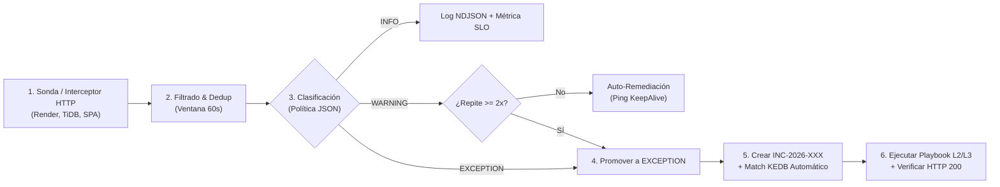

# GUÍA TÉCNICA DE EJECUCIÓN — SEMANA 15: MONITOREO Y GESTIÓN DE EVENTOS (FINNOVA)

**Stack Real:** Angular 22 (Vercel) + Express 5 (Render) + TiDB Cloud (AWS) + GitHub Actions  
**Módulos Implementados:** `/dashboard/event-monitoring` (NOC Live) | `/dashboard/support-changes` (Incidentes, Filtros Corregidos & BD Conocimiento KEDB) | `scripts/event-monitor.mjs`

---

## 0. Subsanación de Feedback Previo (Demo en Vivo — 1 min)
1. **Filtros de bandejas corregidos:** Abrir `/dashboard/support-changes` → probar filtros independientes en **Tablero de Incidentes** (Severidad `P1 - Crítico`, Estado `Completado`, Switch `Solo cerrados en BD Conocimiento`, buscador insensible a tildes/mayúsculas) y en **Bandeja Técnica Unificada** (`Tipo`, `Dimensión`, `¿Aplica Cambio?`, `Estado`, `Severidad`, `Buscar` + botón `Limpiar filtros`).
2. **Base de Conocimiento de Incidencias Cerradas (KEDB):** Abrir pestaña **2. BD de Conocimiento KEDB** → mostrar `KEDB-FIN-001`..`KEDB-FIN-008` con *qué se aplicó paso a paso*, comandos SQL/curl ejecutados, archivos modificados, validación post-cierre y botón **"Aplicar esta solución a un incidente"**.

---

## 1. Clasificación de Eventos (Ejecutable en `/dashboard/event-monitoring`)
| Clase ITIL 4 | Criterio Técnico en Finnova | Acción del Motor |
| :--- | :--- | :--- |
| **`INFO`** | HTTP `200` y latencia `< 1500ms` | Registra telemetría NDJSON y actualiza SLO (`99.9%`). |
| **`WARNING`** | Latencia `1500–4000ms` o HTTP `4xx` (`413`) | Dispara Keep-Alive automático; correlaciona `2x` consecutivos antes de escalar. |
| **`EXCEPTION`** | HTTP `5xx` / `429` / `0` (timeout) o latencia `> 4000ms` | Crea Incidente real `INC-2026-XXX` en bandeja + match automático KEDB + Playbook. |

---

## 2. Flujo de Atención de Eventos (BPMN 2.0 — Ejecutable en Vivo)

*Demostración en vivo:* En `/dashboard/event-monitoring`, pulsar **Ejecutar Sonda Real Ahora** o **+ P1: Pool TiDB** y mostrar cómo cada nodo BPMN se ilumina en vivo con su payload JSON.

---

## 3. Identificación de Incidentes & Matriz de Priorización (Corta)
| Clase \ Criticidad | Core (`TiDB / Auth / Render`) | Negocio (`Solicitudes / Yape`) | Soporte (`UI / Reportes`) |
| :--- | :---: | :---: | :---: |
| **`EXCEPTION`** | **P1 Crítico** (Auto-INC, MTTA ≤ 15m) | **P2 Alto** (Auto-INC, MTTA ≤ 30m) | **P3 Medio** (Ticket L1 ≤ 2h) |
| **`WARNING`** | **P2 Alto** (KeepAlive / 2x→INC) | **P3 Medio** (Correlacionar 2x) | **P4 Bajo** (Log) |
| **`INFO`** | **P4 / Log** | **P4 / Log** | **P4 / Log** |

---

## 4. Políticas de Monitoreo en Vivo (`monitoring/event-policies.json`)
- **Sondeo sintético:** cada `30s` en consola NOC / cada `15m` en `.github/workflows/synthetic-monitor.yml`.
- **Umbrales activos:** `latencyWarnMs: 1500`, `latencyCritMs: 4000`, `timeoutMs: 12000`, `consecutiveWarnToIncident: 2`, `dedupWindowSec: 60`, `max429PerMin: 5`, `dbPoolCritPct: 90%`.
- **Prueba en directo:** En pestaña *Políticas en Vivo*, bajar `WARN` a `100ms`, pulsar **Aplicar Políticas** y ejecutar **Sonda Real Ahora** para disparar una alerta real contra Render.

---

## 5. Plan de Respuesta (Playbooks Ejecutables)
- **`PB-001` (`ER_CON_COUNT_ERROR` → `KEDB-FIN-001`):** `SHOW FULL PROCESSLIST`, elevar `DB_CONNECTION_LIMIT=15`, `enableKeepAlive: true`.
- **`PB-002` (`HTTP_429_RATE_LIMIT` → `KEDB-FIN-002`):** Verificar `app.set('trust proxy', 1)` y cabeceras `X-RateLimit-*`.
- **`PB-003` (`COLD_START_TIMEOUT_504` → `KEDB-FIN-003`):** Disparo Keep-Alive + cron GitHub Actions `*/15`.
- **`PB-004` (`HTTP_413_PAYLOAD_TOO_LARGE` → `KEDB-FIN-004`):** Límite `express.json` + compresión canvas Base64.
- **`PB-005` (`SPA_RUNTIME_EXCEPTION` → `KEDB-FIN-006`):** Captura en `GlobalEventErrorHandler` + Instant Rollback Vercel.

---

## 6. Herramientas Implementadas y Comandos de Demostración
1. **Telemetría Real en Frontend:** `src/app/services/telemetry.interceptor.ts` + `GlobalEventErrorHandler` (activos en `src/main.ts`).
2. **Agente Sintético CLI (Node 22):**
   ```powershell
   npm run monitor          # Sonda real en vivo contra Vercel + Render + TiDB
   npm run monitor:drill    # Simulacro P1 con correlación, match KEDB y log NDJSON
   npm run monitor:watch    # Vigilancia continua en consola cada 30s
   ```
3. **Prometheus + Alertmanager (IaC):** `monitoring/prometheus/prometheus.yml` y `monitoring/prometheus/alert-rules.yml`.
4. **Monitoreo 24/7 Automatizado:** `.github/workflows/synthetic-monitor.yml` (cron cada 15 min + artefacto `events.ndjson` + webhook opcional `ALERT_WEBHOOK_URL`).

---

## 7. Recomendaciones Técnicas de Mejora Operativa
1. **`GET /api/health/deep` en Render:** exponer `SELECT 1` + métricas activas del pool `mysql2` para detectar saturación al 70% antes de `ER_CON_COUNT_ERROR`.
2. **OpenTelemetry + `X-Correlation-Id`:** propagar trace ID desde `telemetryInterceptor` hasta Express y TiDB.
3. **Retry exponencial + Circuit Breaker:** en consultas `GET` idempotentes del catálogo para absorber micro-cortes.
4. **Webhook Alertmanager → Jira/Slack:** habilitar secret `ALERT_WEBHOOK_URL` en GitHub Actions para alertamiento automático `< 15s`.
